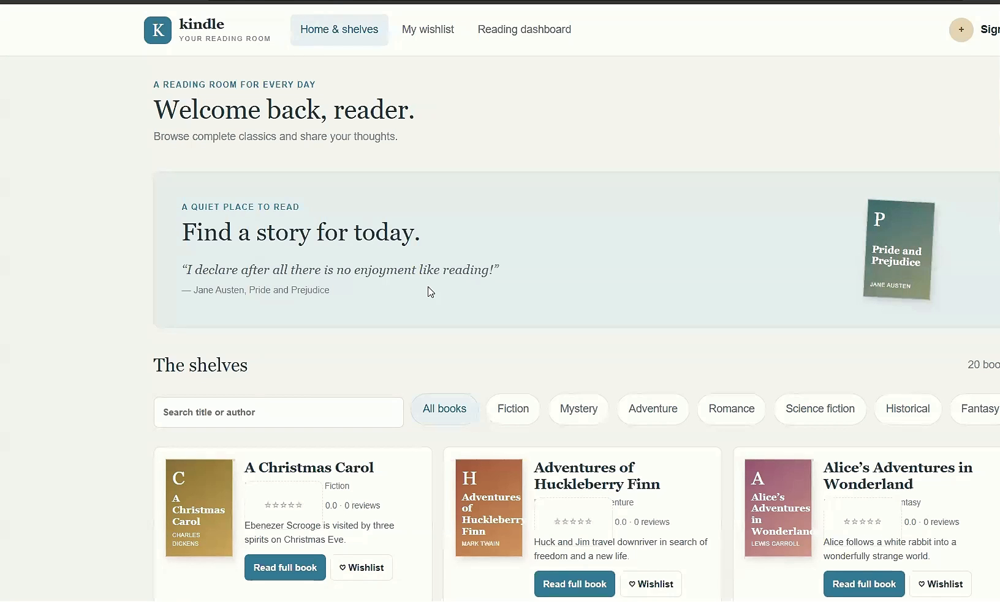

# Kindle

## Book Reading and Rating System

CSE326 Project by **Team Sync3**  
**Harshit, Tarun, and Prathish**

Kindle brings a twenty-book catalog, an on-site text reader, wishlists, saved reading positions, and reader reviews into one browser interface. The frontend uses HTML, CSS, and JavaScript. Supabase supplies authentication and shared database storage.



## Features

- Browse twenty included classics and search by title or author.
- Filter the shelves by genre.
- Read the included book text inside the site without an external redirect.
- Stop reading and restore a relative scroll position later.
- Create or edit a reader profile and favourite genre.
- Save books to a per-reader wishlist.
- Rate a book from one to five stars and write an experience note.
- Order the shelves by average rating, then review count, then title.
- Recommend the highest-rated eligible book in the selected or favourite genre.
- Review personal activity on the reading dashboard.

## Project structure

```text
index.html
style.css
app.js
supabase-schema.sql
books/                   twenty text files
docs/images/             recorded demo screenshots
docs/PROJECT_OVERVIEW.md
docs/GITHUB_UPLOAD.md
SECURITY.md
.gitignore
SOURCE-MANIFEST.json
```

## Technologies

| Technology | Responsibility |
| --- | --- |
| HTML5 | Page structure, navigation, forms, and dialog targets |
| CSS | Cream and teal theme, cards, reader layout, responsive breakpoints |
| JavaScript | State, rendering, events, searching, rating maths, SDK calls |
| PostgreSQL SQL and PL/pgSQL | Tables, constraints, RLS policies, signup trigger |
| Supabase JS SDK v2 | Browser connection to Auth, database APIs, realtime |
| Cloudflare Pages | Static deployment used for this project |
| Browser APIs | DOM, fetch, localStorage, timers, requestAnimationFrame |

## Run locally

1. Download or clone this repository.
2. Open its folder in VS Code.
3. Serve the folder through an HTTP preview/server, such as your existing Live Server setup.
4. Open the resulting HTTP URL in a browser.

The frontend needs no npm installation or build step. Keep `books/` next to `index.html`. Directly opening a `file://` URL may prevent the reader's `fetch()` requests from loading text. Shared account features and the external SDK need internet access.

## Supabase configuration

`app.js` lines 1 and 2 contain the project URL and browser publishable key from the working source snapshot. A publishable key is public browser configuration. No service-role key or database password is included.

To run an independent copy:

1. Use the intended Supabase project and set its URL and browser publishable key in `app.js`.
2. Review and run `supabase-schema.sql` in that project. It creates the four application tables, policies, signup trigger, and review realtime publication entry.
3. Configure Auth options and allowed site/redirect URLs for your local and hosted origins.
4. Verify account creation, sign-in, and row ownership using your own test accounts.

Email confirmation is a Supabase Auth setting. The frontend handles either an immediate signup session or a confirmation-required response. The SQL file does not change that setting.

## Rating and recommendation logic

Average rating equals the sum of submitted ratings divided by their count. An unrated book starts at zero. Each reader has at most one review per book, and an upsert updates that review instead of creating another vote.

Shelf order is average descending, review count descending for equal averages, then title alphabetically. More reviews do not override a lower average. The top recommendation requires at least one review. A selected genre takes priority; with All books selected, a saved favourite genre can supply the recommendation category. Search text filters the shelves separately.

## Data and current limits

- The supplied SQL permits community review reads for authenticated users only. Guests can browse/read the static catalog and book files, but may receive no community review rows.
- Local fallback is browser-local profile/data storage, not secure account authentication or cross-device sharing.
- Books finished on the dashboard is the reader's submitted-review count.
- Resume uses a scroll fraction. Home chooses the first positive-progress book in catalog order.
- The current source has no admin upload screen, review moderation, or verified reading-completion check.
- See `SECURITY.md` and `docs/PROJECT_OVERVIEW.md` for implementation details and limitations.

## Deployment

Publish `index.html`, `style.css`, `app.js`, and the complete `books/` directory together on the intended static host. Configure the Supabase project separately. Publishing static files does not execute database SQL. The project has used Cloudflare Pages for hosting. This repository does not create a deployment automatically.

## Upload to GitHub

See [the upload guide](docs/GITHUB_UPLOAD.md). Extract this package and upload the project files, rather than uploading this ZIP as the repository's only file.

## Book text notices

The text files retain their source and licence notices. Preserve those notices when redistributing the files. The inclusion check confirms matching catalog filenames and expected text markers, rather than an independent legal or literary audit. No separate licence for the team's own application code is assigned by this package.

## Project documentation

The accompanying project report and presentation describe this source snapshot. Screenshots show the recorded demonstration, rather than a newly verified live deployment.
